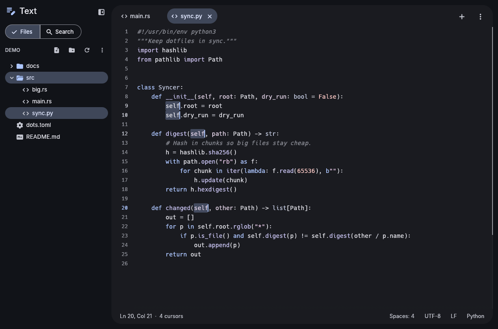
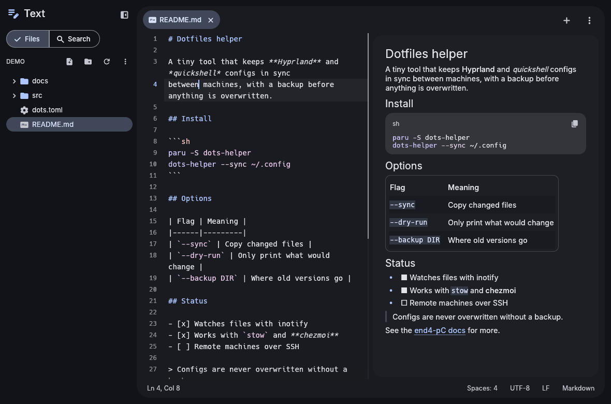
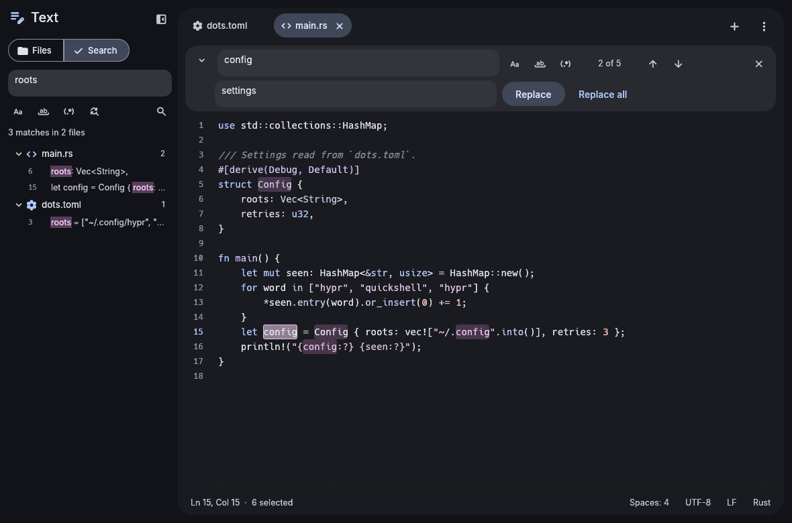
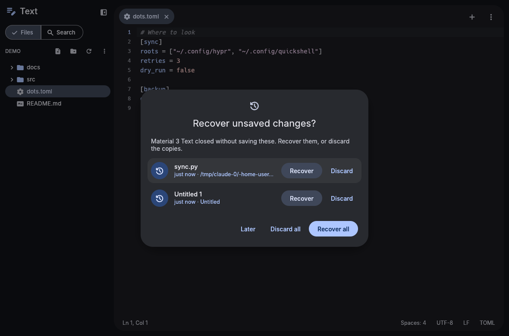

# Material 3 Text

A light code and text editor, built with [egui](https://github.com/emilk/egui) and themed with Material You. It's one of the Material 3 apps for the [end4-pC](https://github.com/bhimio1/end4-pC) desktop: it shares its look with Settings and the File Manager through [material-3-ui](https://github.com/bhimio1/material-3-ui), and it takes its colors from your wallpaper, like the shell does. Syntax colors are made from the same palette, so code recolors with the rest of the desktop.






## Features

**Editing**
- **Tabs:** a dot marks unsaved changes. Middle-click closes a tab, and you can drag tabs to reorder them. Right-click for close others, close to the right, copy path, and reveal in the sidebar. Ctrl+Shift+T reopens the last closed tab.
- **Fast with big files:** the editor is a custom widget over a rope, and it only lays out the lines on screen. Highlighting runs on a background thread, and lines it hasn't reached yet are colored from a quick guess. A 6 MB, 340,000-line file opens, scrolls and edits without stutter.
- **Syntax highlighting** with syntect and bat's syntax collection. That covers Rust, Python, JavaScript/TypeScript, C/C++, Go, shell (bash, zsh, fish, PKGBUILD), Lua, QML, TOML, YAML, JSON, INI and `.conf`, Markdown, CSS, HTML, Nix, Dockerfiles, diffs and many more. Pick another language from the status bar.
- **Undo and redo:** typing is grouped into words, and a reload from disk can be undone too.
- **Multiple cursors:**
  - Shift+Alt+↑/↓ adds a caret on the line above or below.
  - Alt+click adds a caret where you click.
  - Ctrl+D selects the next occurrence of the selection.
  - Pasting several lines puts one line at each caret.
- **Find and replace (Ctrl+F, Ctrl+H):**
  - match case, whole word, and regular expressions with `$1` groups;
  - Enter and Shift+Enter step through the matches, with an "n of N" count.
- **Find in folder (Ctrl+Shift+F):**
  - searches the open folder in the background, skipping what `.gitignore` excludes;
  - results are grouped by file, and clicking one opens the file at the match;
  - "Replace all" changes files that are open in their tabs (unsaved), and saves the others right away.
- **Line tools:**
  - go to line (Ctrl+G, or `:42` in quick open);
  - toggle comments (Ctrl+/), with the right markers for each language;
  - indent and outdent selections (Tab, Shift+Tab);
  - move lines (Alt+↑/↓), duplicate lines (Ctrl+Shift+D), delete lines (Ctrl+Shift+K);
  - add a line below or above (Ctrl+Enter, Ctrl+Shift+Enter).
- **Typing helpers:** new lines keep their indentation and indent after `{`, `[`, `(` (and `:` in Python and YAML). A closing bracket typed on a blank line outdents it. Matching brackets are outlined, and Ctrl+M jumps between them.
- **View:** word wrap (Alt+Z) breaks lines after spaces. You can show whitespace, highlight the current line, and change the font size with Ctrl+= and Ctrl+-.
- **Markdown preview (Ctrl+Shift+M):** shown side by side with the text. It renders headings, lists, tables, quotes, links and code blocks, with the code highlighted the same way.

**Files**
- **Folders:** opening a folder shows its files in the sidebar. Ignored files are hidden, and there's a toggle to show them, along with hidden files. Right-click to create, rename, or move to the trash. The tree follows changes on disk.
- **Quick open (Ctrl+P):** fuzzy-find any file in the folder. Without a folder, it lists your open and recent files.
- **Encodings:** UTF-8 (with or without BOM), UTF-16 and legacy encodings are detected, with Windows-1252/Latin-1 as the fallback. Files are saved back in the same encoding. Line endings (LF, CRLF, CR) are kept too. You can change either from the status bar, or reopen a file in another encoding.
- **Safe saving:**
  - Files are replaced atomically, keeping their permissions. Files with hard links are rewritten in place.
  - Symlinked dotfiles (stow, chezmoi) are written through the link.
  - Files you can't write are saved through `pkexec`, after one password prompt.
- **Changes on disk:** a file changed by another program reloads by itself when you have no unsaved changes. Otherwise a banner asks whether to reload or keep your version. Deleted files are flagged too.
- **Crash recovery:** unsaved changes are copied to `~/.local/state/m3-text/swap` a moment after you stop typing. If the editor closes without saving, it offers to recover them the next time it starts.
- **Autosave**, trimming trailing whitespace, and a final newline are all optional.
- **Status bar:** line and column, selection size or cursor count, indentation (with conversion between tabs and spaces), encoding, line endings, and language.

## Install

From the AUR, prebuilt or built from source:

```sh
paru -S material-3-text-bin   # or material-3-text-git
```

From this repository, with the included PKGBUILD:

```sh
cd packaging
makepkg -si
```

Prebuilt x86_64 binaries are attached to [releases](https://github.com/bhimio1/material-3-text/releases). On end4-pC, install it from Material 3 Settings → Material 3 apps.

Or build directly:

```sh
cargo build --release
./target/release/m3-text [FILE|DIR]... [+LINE]
```

## Command line

```
m3-text notes.md                 open a file
m3-text ~/projects/dots          open a folder in the sidebar
m3-text main.rs +40              go to line 40 (also: main.rs:40 or main.rs:40:7)
m3-text +12 a.txt b.txt          line 12 of a.txt
journalctl -b | m3-text -        read standard input into a new tab
```

A file that doesn't exist yet opens as a new, empty tab, and saving creates it. To make it your default editor:

```sh
xdg-mime default material_3_text.desktop text/plain text/markdown
```

## Theme and settings

In Preferences (Ctrl+,), **Auto** uses the end-4 shell's generated colors (`~/.local/state/quickshell/user/generated/colors.json`). If those don't exist it uses the file manager's matugen `theme.json`, and otherwise a seed color. The theme and the syntax colors update live when the wallpaper changes.

Settings are stored in `~/.config/m3-text/config.toml`. They include the shared Appearance section, plus `[editor]` options for the font size, tab width, spaces or tabs, indentation detection, word wrap, whitespace, line numbers, autosave, reloading changed files, trimming whitespace and the final newline. Recent files and folders are kept in `~/.local/state/m3-text/recent.json`.

## Keyboard

| | |
|---|---|
| Ctrl+N / Ctrl+O / Ctrl+Shift+O | new file / open file / open folder |
| Ctrl+S / Ctrl+Shift+S / Ctrl+Alt+S | save / save as / save all |
| Ctrl+W / Ctrl+Shift+T | close tab / reopen closed tab |
| Ctrl+Tab, Ctrl+PageDown / PageUp, Alt+1…9 | switch tabs |
| Ctrl+P / Ctrl+G | quick open / go to line |
| Ctrl+F / Ctrl+H / F3 / Shift+F3 | find / replace / next / previous |
| Ctrl+Shift+F | find in folder |
| Ctrl+/ | toggle comment |
| Ctrl+D | select next occurrence |
| Shift+Alt+↑/↓, Alt+click | add cursor |
| Alt+↑/↓ | move lines |
| Ctrl+Shift+D / Ctrl+Shift+K | duplicate / delete lines |
| Ctrl+L | select line |
| Ctrl+] / Ctrl+[ | indent / outdent |
| Ctrl+M | jump to matching bracket |
| Alt+Z / Ctrl+B / Ctrl+Shift+M | word wrap / sidebar / Markdown preview |
| Ctrl+= / Ctrl+- / Ctrl+0 | font size |
| F5 | reload from disk |

## Project layout

```
src/
  app.rs        app state, documents, actions, timers (swap, autosave, disk checks)
  buffer.rs     the rope, selections and multi-cursor editing, undo history
  editor.rs     the virtualized editor widget: layout metrics, input, painting
  layout.rs     tab expansion and word wrap in display columns
  syntax.rs     syntect highlighting: palette-independent tokens, background parsing
  document.rs   an open file: encoding, line endings, find cache, reload
  encoding.rs   encoding and line-ending detection and conversion
  files.rs      loading and saving (atomic, through symlinks, pkexec)
  swap.rs       crash-recovery swap files
  search.rs     find/replace and the background folder search
  tree.rs       the sidebar file tree, quick-open index and fuzzy matching
  markdown.rs   the Markdown preview
  config.rs     preferences and recent files
  cli.rs        command-line parsing
  ui/           tabs, sidebar, find bar, status bar, dialogs
  ui_ext.rs     small UI helpers (candidates for material-3-ui)
```

Run the tests with `cargo test`.

## License

MIT, see [LICENSE](LICENSE).

Fonts: Inter (SIL OFL 1.1, see `assets/LICENSE-Inter.txt`). Icons: Material Symbols, via `egui_material_icons`. Syntax definitions: syntect and bat's collection via `two-face` (MIT/Apache-2.0).
